

  <a href="https://icmsamet.com">
    
  </a>
  
<b>English</b> · <a href="https://github.com/icmsamet/icmsamet/blob/main/README.tr.md">Türkçe</a>

## What we do


Our core is software and games, and we also run production and event work. If your project doesn't fit neatly into one of these, that's fine: tell us what you have in mind.

- **Game development:** PC and mobile games in Unity and C#. Gameplay systems, level and UI flow, save and progression, performance work and a release-ready build.
- **Custom applications:** desktop and mobile apps built to do one job properly. Internal tools, control panels, data entry and reporting screens.
- **Automation systems:** work you repeat by hand, turned into something that runs on its own. File operations, moving data between systems, scheduled jobs, device control.
- **Hardware & robotics:** software that talks to the physical world. Sensors, motor and driver control, serial and network communication, and the interface people actually use.
- **Rescuing existing projects:** a codebase left on your hands, a stalled project, or a system that no longer keeps up. We read the current state first, tell you plainly what it needs, then carry on.
- **3D printing & production:** part design, prototypes and batch printing, from product idea to something you can hold.
- **Anything not on this list:** we find the right maker or supplier and manage the job end to end. You deal with one party: us.

 

## Selected work

A selection of the work we can share publicly. Most studio projects are under NDA.

<table>
  <tr>
    <td width="33%" valign="top">
      <a href="https://play.google.com/store/apps/details?id=com.funnyplaygames.bikesimulator.policebike">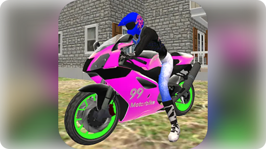</a>
       <b>Police Bike Simulator</b>
       Unity · C# · Google Play · Moon Star Games
    </td>
    <td width="33%" valign="top">
      <a href="https://www.crazygames.com/game/roller-coaster-rush">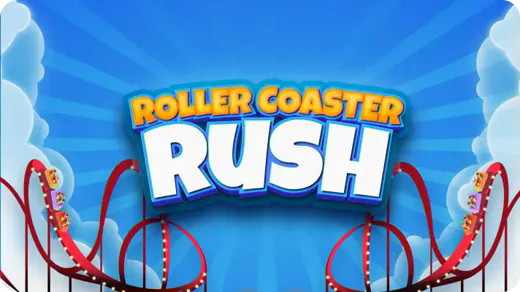</a>
       <b>Roller Coaster Rush</b>
       Unity · C# · CrazyGames · Trifles Games
    </td>
    <td width="33%" valign="top">
      <a href="https://www.crazygames.com/game/agents-io">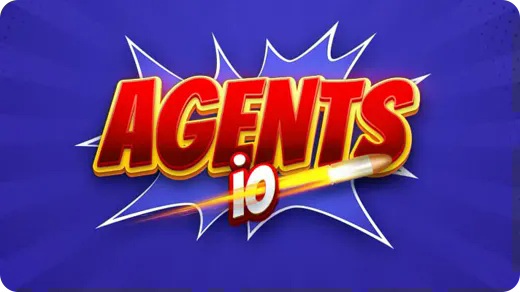</a>
       <b>Agents.io</b>
       Unity · C# · CrazyGames · Trifles Games
    </td>
  </tr>
  <tr>
    <td valign="top">
      <a href="https://apps.apple.com/us/app/ne-yiyelim/id6817894257">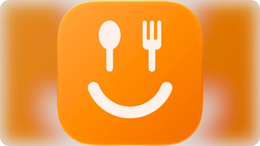</a>
       <b>Ne Yiyelim?</b>
       App Store · 2026 · turns choosing what to eat into a game
    </td>
    <td valign="top">
      <a href="https://www.crazygames.com/game/vortex-io">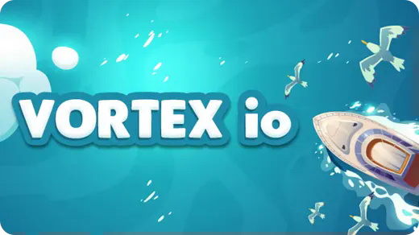</a>
       <b>Vortex.io</b>
       Unity · C# · CrazyGames · Trifles Games
    </td>
    <td valign="top">
      <a href="https://www.crazygames.com/game/fashion-famous">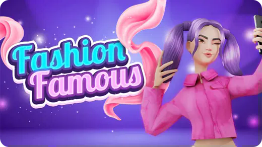</a>
       <b>Fashion Famous</b>
       Unity · C# · CrazyGames · Trifles Games
    </td>
  </tr>
  <tr>
    <td valign="top">
      <a href="https://www.crazygames.com/game/fashion-challenge-catwalk-run">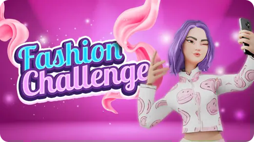</a>
       <b>Fashion Challenge: Catwalk Run</b>
       Unity · C# · CrazyGames · Trifles Games
    </td>
    <td valign="top">
      <a href="https://icmsamet.com/isler">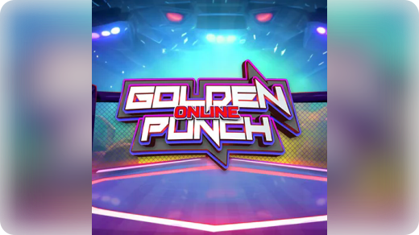</a>
       <b>Golden Punch Online</b>
       Unity · C# · multiplayer · Ludum Art Studio
    </td>
    <td valign="top">
      <a href="https://www.youtube.com/watch?v=A5HHTxt5t2w">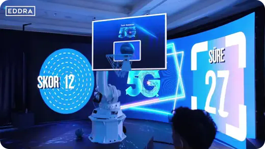</a>
       <b>Robot Basketball</b>
       Robotics · event · Eddra
    </td>
  </tr>
  <tr>
    <td valign="top">
      <a href="https://www.youtube.com/watch?v=Ielyu3-BHJQ">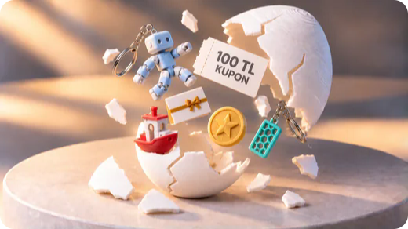</a>
       <b>Crack the Egg, Win a Prize</b>
       3D printing · event · branded prizes inside
    </td>
    <td valign="top">
      <a href="https://www.youtube.com/watch?v=MBvIXeJGy0w">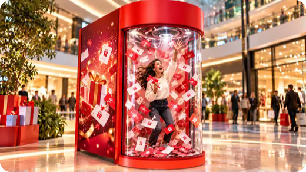</a>
       <b>Catch the Flyers</b>
       Event · sensor · Eddra
    </td>
    <td valign="middle" align="center">
      <a href="https://icmsamet.com/isler">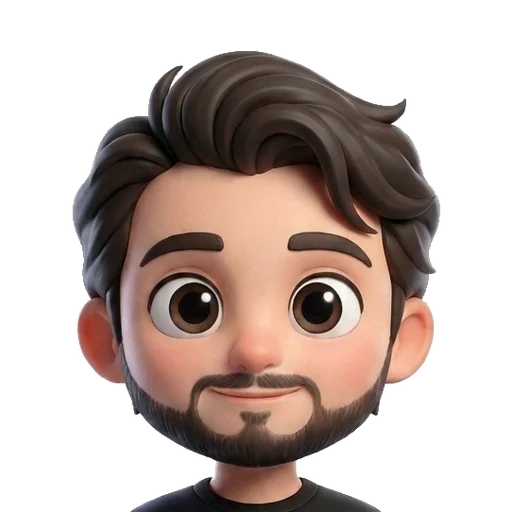</a>
       <a href="https://icmsamet.com/isler"><b>All work →</b></a>
       icmsamet.com/isler
    </td>
  </tr>
</table>

## What they said

<a href="https://icmsamet.com/#yorumlar"></a>

## How we work

| 1 · Let's talk | 2 · Scope & quote | 3 · Build | 4 · Delivery & after |
|---|---|---|---|
| We listen to the problem and what you already have, and agree on what is needed and what is not. | You get the scope, timeline and price in writing. Surprises are discussed at the start. | You see a working build at regular intervals. A wrong direction shows up at the first demo. | The source code, the setup and how it works stay with you. We're still around afterwards. |

## About me

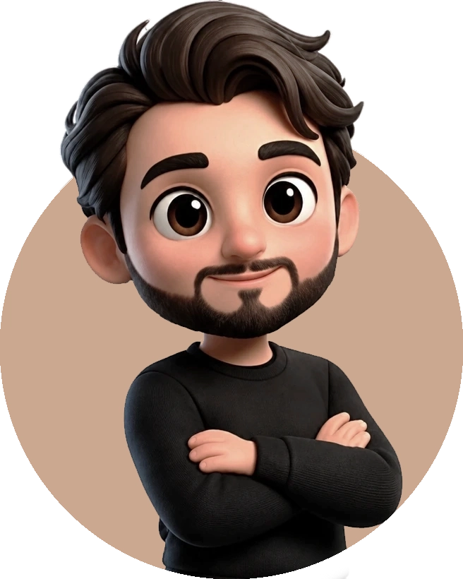

I'm a software and game developer with 8 years of experience across a wide range of technical projects, 5 of them in the game industry.

My main tools are Unity and C#, but I don't limit myself to one field. I've worked on games, applications, automation systems, multiplayer projects, hardware-based systems, robotics and other custom solutions.

I enjoy projects that need more than code: understanding the problem, finding the right approach, and turning an idea into something that actually works. When a project outgrows one person, I bring in developers I work with regularly, and I stay your point of contact.

 

## Let's start

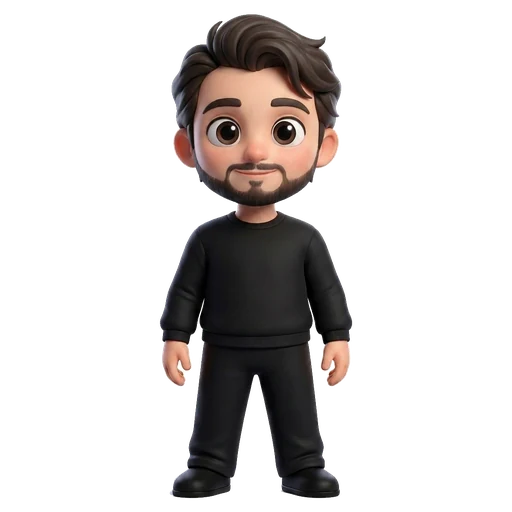

A short description of the problem, your idea and a deadline if you have one is enough to start. We usually reply the same day, and we say plainly if the work isn't a fit.

  
  
  
  

✉️ [icmsamet@gmail.com](mailto:icmsamet@gmail.com)

 

© 2026 Samet İçim · Your project partner
