

  <a href="https://icmsamet.com">
    
  </a>
  
<a href="https://github.com/icmsamet">English</a> · <b>Türkçe</b>

## Ne yapıyoruz


Çekirdeğimiz yazılım ve oyun; üretim ve etkinlik işlerini de yürütüyoruz. Projeniz tam olarak birine oturmuyorsa sorun değil, aklınızdaki işi anlatın.

- **Oyun geliştirme:** Unity ve C# ile PC ve mobil oyunlar. Oynanış sistemleri, bölüm ve arayüz akışı, kayıt ve ilerleme yapısı, performans optimizasyonu ve yayına hazır build.
- **Özel uygulamalar:** tek bir işi düzgün yapsın diye yazılan masaüstü ve mobil uygulamalar. Şirket içi araçlar, kontrol panelleri, veri girişi ve raporlama ekranları.
- **Otomasyon sistemleri:** elle tekrar tekrar yapılan işleri kendi başına çalışan bir yapıya çeviriyoruz. Dosya işlemleri, sistemler arası veri aktarımı, zamanlanmış görevler, cihaz kontrolü.
- **Donanım ve robotik:** fiziksel dünyayla konuşan yazılım. Sensörler, motor ve sürücü kontrolü, seri port ve ağ haberleşmesi, bir de kullanacak kişinin karşısına çıkan arayüz.
- **Devralınan projeler:** elinizde kalmış bir kod tabanı, duraklamış bir proje ya da çalışan ama yetmeyen bir sistem. Önce mevcut durumu okuyup ne gerektiğini açıkça söylüyor, sonra oradan devam ediyoruz.
- **3D baskı ve üretim:** parça tasarımı, prototip ve seri baskı. Ürün fikrinden elle tutulur örneğe.
- **Listede olmayan işler:** kendimiz yapamıyorsak doğru üretici ya da tedarikçiyi bulup işi baştan sona biz yönetiyoruz. Muhatabınız tek: biz.

 

## Neler yaptık

Herkese açık paylaşabildiğimiz işlerden bir seçki. Stüdyo projelerinin çoğu gizlilik anlaşması kapsamında olduğu için burada yok.

<table>
  <tr>
    <td width="33%" valign="top">
      <a href="https://play.google.com/store/apps/details?id=com.funnyplaygames.bikesimulator.policebike">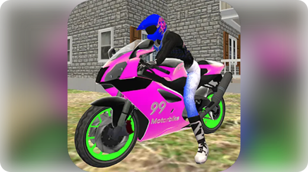</a>
       <b>Police Bike Simulator</b>
       Unity · C# · Google Play · Moon Star Games
    </td>
    <td width="33%" valign="top">
      <a href="https://www.crazygames.com/game/roller-coaster-rush">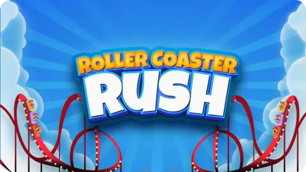</a>
       <b>Roller Coaster Rush</b>
       Unity · C# · CrazyGames · Trifles Games
    </td>
    <td width="33%" valign="top">
      <a href="https://www.crazygames.com/game/agents-io">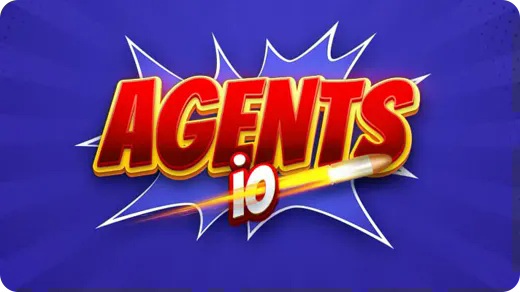</a>
       <b>Agents.io</b>
       Unity · C# · CrazyGames · Trifles Games
    </td>
  </tr>
  <tr>
    <td valign="top">
      <a href="https://apps.apple.com/us/app/ne-yiyelim/id6817894257">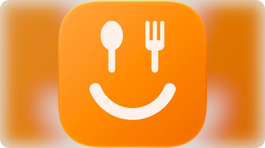</a>
       <b>Ne Yiyelim?</b>
       App Store · 2026 · yemek seçme derdini oyuna çeviriyor
    </td>
    <td valign="top">
      <a href="https://www.crazygames.com/game/vortex-io">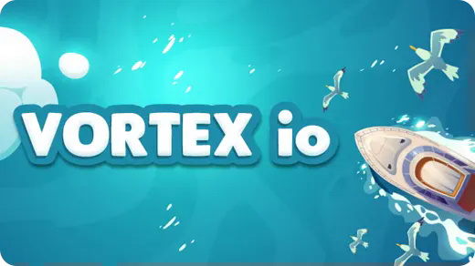</a>
       <b>Vortex.io</b>
       Unity · C# · CrazyGames · Trifles Games
    </td>
    <td valign="top">
      <a href="https://www.crazygames.com/game/fashion-famous">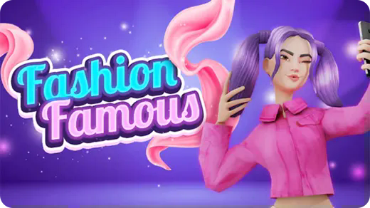</a>
       <b>Fashion Famous</b>
       Unity · C# · CrazyGames · Trifles Games
    </td>
  </tr>
  <tr>
    <td valign="top">
      <a href="https://www.crazygames.com/game/fashion-challenge-catwalk-run">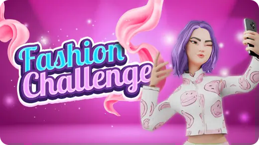</a>
       <b>Fashion Challenge: Catwalk Run</b>
       Unity · C# · CrazyGames · Trifles Games
    </td>
    <td valign="top">
      <a href="https://icmsamet.com/isler">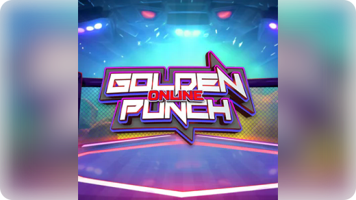</a>
       <b>Golden Punch Online</b>
       Unity · C# · çok oyunculu · Ludum Art Studio
    </td>
    <td valign="top">
      <a href="https://www.youtube.com/watch?v=A5HHTxt5t2w">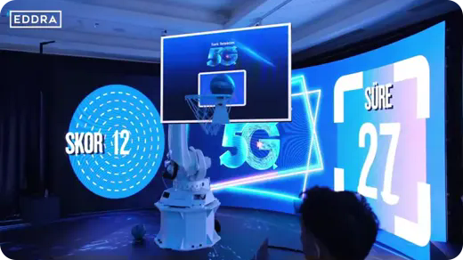</a>
       <b>Robot İle Basket</b>
       Robotik · etkinlik · Eddra
    </td>
  </tr>
  <tr>
    <td valign="top">
      <a href="https://www.youtube.com/watch?v=Ielyu3-BHJQ">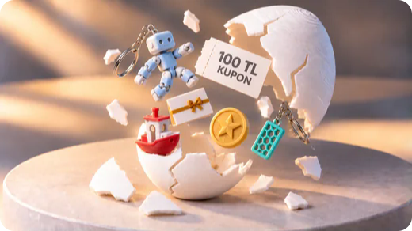</a>
       <b>Yumurtayı Kır Hediyeyi Kazan</b>
       3D baskı · etkinlik · içinde markaya özel hediyeler
    </td>
    <td valign="top">
      <a href="https://www.youtube.com/watch?v=MBvIXeJGy0w">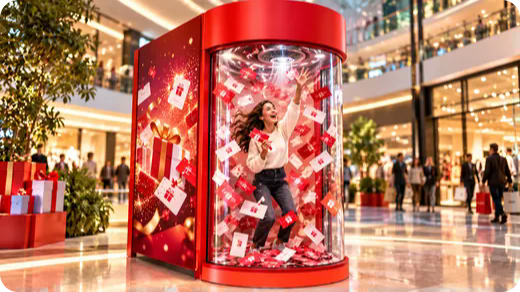</a>
       <b>Uçanları Yakala</b>
       Etkinlik · sensör · Eddra
    </td>
    <td valign="middle" align="center">
      <a href="https://icmsamet.com/isler">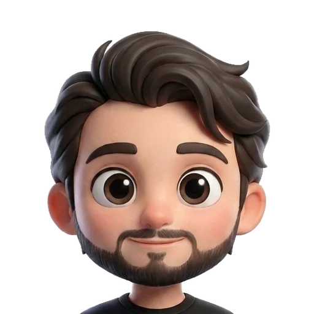</a>
       <a href="https://icmsamet.com/isler"><b>Tüm işler →</b></a>
       icmsamet.com/isler
    </td>
  </tr>
</table>

## Ne dediler

<a href="https://icmsamet.com/#yorumlar"></a>

## Nasıl çalışıyoruz?

| 1 · Konuşalım | 2 · Kapsam ve teklif | 3 · Geliştirme | 4 · Teslim ve sonrası |
|---|---|---|---|
| Problemi ve elinizdekini dinliyoruz. Ne gerektiğini, nelerin gerekmediğini birlikte netleştiriyoruz. | Ne yapılacağını, ne kadar süreceğini ve fiyatını yazılı veriyoruz. Sürprizi işin başında konuşuyoruz. | Düzenli aralıklarla çalışan sürüm gösteriyoruz. Yön yanlışsa ilk demoda ortaya çıkıyor. | Kaynak kod, kurulum ve nasıl çalıştığı sizde kalır. Teslimden sonra da yanınızdayız. |

## Hakkımda

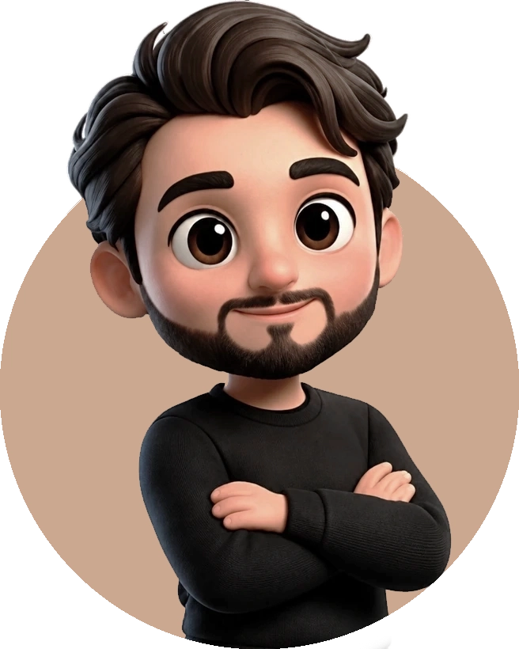

8 yıllık deneyime sahip bir yazılım ve oyun geliştiricisiyim. Bu sürenin 5 yılında oyun sektöründe olmak üzere birçok farklı teknik proje üzerinde çalıştım.

Ana uzmanlık alanlarım Unity ve C# olsa da kendimi belirli bir alanla sınırlamıyorum. Oyunlar, uygulamalar, otomasyon sistemleri, multiplayer projeler, donanım tabanlı sistemler, robotik ve çeşitli özel çözümler üzerinde çalıştım.

Sadece kod yazmaktan fazlasını gerektiren projelerden keyif alıyorum: problemi anlamak, doğru yaklaşımı bulmak ve bir fikri gerçekten çalışan bir ürüne dönüştürmek. Kapsam tek kişiyi aştığında birlikte çalıştığım geliştiricilerle ekip kurup ilerliyoruz; muhatabınız yine ben oluyorum.

 

## Hadi başlayalım

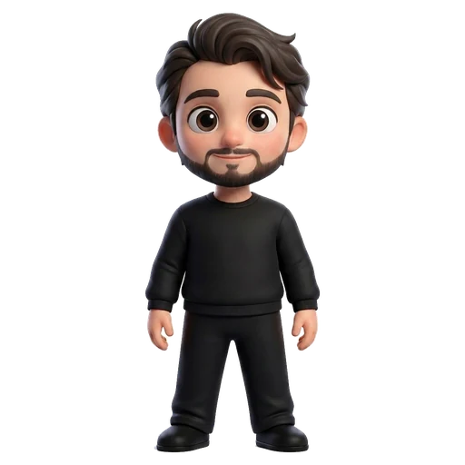

Problemin kısa bir tarifi, aklınızdaki fikir ve varsa teslim tarihi başlamak için yeterli. Genelde aynı gün dönüyoruz; işin bize uygun olup olmadığını da açıkça söylüyoruz.

  
  
  
  

✉️ [icmsamet@gmail.com](mailto:icmsamet@gmail.com)

 

© 2026 Samet İçim · Proje çözüm ortağı
